# EQ Tech Platform: Modern Financial Engineering on Azure AKS
## A Mono-Repo, AI-Ready, Cloud-Native Architecture

---

## Slide 1 — The Problem We Solved

**Before: Fragmented Infrastructure**

- Multiple disconnected repositories — no shared code, no shared standards
- Manual deployments with undocumented steps
- Secrets scattered across machines and developer laptops
- No consistent environments between dev, UAT, and production
- Data pipelines, APIs, and dashboards maintained by separate teams with no shared contracts
- New developers took weeks to onboard

**After: One Repo, One Truth, Three Environments**

- Single GitHub repo governs everything: code, infrastructure, config, CI/CD
- Push to a branch → environment is updated automatically
- All credentials live in Azure Key Vault — no secrets ever touch a laptop
- Dev, UAT, and prod are structurally identical — what works in dev ships to prod

---

## Slide 2 — Architecture Overview (Infrastructure Perspective)

```mermaid
graph TB
    subgraph Internet
        Browser[Browser / API Client]
        GitHub[GitHub Enterprise]
        LE[Let's Encrypt ACME]
    end

    subgraph Azure["Azure (centralus)"]
        subgraph AKS["AKS Cluster — eq-tech-aks"]
            subgraph ingress["Ingress Layer"]
                NGINX[NGINX Ingress Controller<br/>LB: 52.185.94.105]
                PROXY_DEV[oauth2-proxy dev-auth]
                PROXY_UAT[oauth2-proxy uat-auth]
                PROXY_PROD[oauth2-proxy prod-auth]
                CM[cert-manager<br/>Let's Encrypt TLS]
            end
            subgraph dev["dev namespace"]
                AIRFLOW_DEV[Airflow dev<br/>scheduler · webserver · triggerer]
                API_DEV[FastAPI dev]
                DASH_DEV[Dash dev]
                WEB_DEV[Web UI dev]
            end
            subgraph uat["uat namespace"]
                AIRFLOW_UAT[Airflow uat]
                API_UAT[FastAPI uat]
                DASH_UAT[Dash uat]
                WEB_UAT[Web UI uat]
            end
            subgraph prod["prod namespace"]
                AIRFLOW_PROD[Airflow prod]
                API_PROD[FastAPI prod]
                DASH_PROD[Dash prod]
                WEB_PROD[Web UI prod]
            end
        end

        ACR[Azure Container Registry<br/>eqtechacr]
        PG[PostgreSQL Flexible Server<br/>airflow_dev · airflow_uat · airflow_prod]
        KV[Azure Key Vault<br/>eq-tech-kv]
        ENTRA[Entra ID<br/>SSO + Group RBAC]
        DEVVM[Dev Server<br/>eq-tech-devbox]
    end

    Browser -->|HTTPS| NGINX
    NGINX --> PROXY_DEV & PROXY_UAT & PROXY_PROD
    PROXY_DEV & PROXY_UAT & PROXY_PROD -->|Entra OIDC| ENTRA
    NGINX --> API_DEV & API_UAT & API_PROD
    NGINX --> DASH_DEV & DASH_UAT & DASH_PROD
    NGINX --> AIRFLOW_DEV & AIRFLOW_UAT & AIRFLOW_PROD
    CM -->|HTTP-01 challenge| LE
    GitHub -->|OIDC push images| ACR
    ACR --> AKS
    API_DEV & API_UAT & API_PROD --> PG
    AIRFLOW_DEV & AIRFLOW_UAT & AIRFLOW_PROD --> PG
    KV -.->|secrets| AKS
    DEVVM -.->|kubectl · airflow dev| AKS
```

---

## Slide 3 — Architecture Overview (App Developer Perspective)

```mermaid
graph LR
    subgraph Mono-Repo["eq_tech mono-repo (GitHub)"]
        direction TB
        LIB[lib/\nconfig · auth · db · logging\nportfolio · metrics]
        APPS[apps/\napi · ui-dash · ui-web]
        DAGS[data/airflow/dags/\ndaily_etl_dag.py]
        K8S[k8s/\ningress · apps manifests]
        HELM[infra/helm/\nairflow-values/dev|uat|prod]
        REQS[requirements/\nbase · dev · prod]
        CI[.github/workflows/\nlint-test · apps-ci\nairflow-helm-deploy · infra-ci]
    end

    LIB -->|imported by| APPS
    LIB -->|imported by| DAGS
    APPS -->|built & pushed| ACR[ACR Images]
    CI -->|triggers on branch| PIPELINE

    subgraph PIPELINE["CI/CD Pipeline"]
        direction TB
        LINT[1. Lint + 22 Tests]
        BUILD[2. Build multi-arch Docker\nlinux/amd64 + linux/arm64]
        DEPLOY[3. kubectl apply\nper-env namespace]
    end

    LINT --> BUILD --> DEPLOY

    DEPLOY -->|develop branch| DEV_ENV[dev environment]
    DEPLOY -->|uat branch| UAT_ENV[uat environment]
    DEPLOY -->|main branch| PROD_ENV[prod environment]

    subgraph Each_Env["Each environment gets"]
        direction TB
        E1[Airflow — DAG execution]
        E2[FastAPI — REST API + Swagger]
        E3[Dash — Analytics Dashboard]
        E4[Web UI — Static portal]
        E5[oauth2-proxy — Entra SSO]
    end
```

---

## Slide 4 — Why Mono-Repo?

**One repository contains everything the platform needs**

| Layer | Location in repo |
|-------|-----------------|
| Shared libraries | `lib/` |
| Applications | `apps/api/`, `apps/ui-dash/`, `apps/ui-web/` |
| DAGs | `data/airflow/dags/` |
| Kubernetes manifests | `k8s/` |
| Helm values (per env) | `infra/helm/airflow-values/` |
| CI/CD workflows | `.github/workflows/` |
| Scripts | `scripts/` |
| Tests | `tests/` |

**Key benefits**

- **Atomic changes**: A single PR can change the lib, the API that uses it, and the DAG that calls the API together
- **Unified versioning**: One git SHA describes the entire system state
- **No version hell**: `lib/` is always compatible with `apps/` because they share a commit
- **Single test suite**: 22 tests cover all layers — run with one command
- **Discoverability**: Any developer can find any piece of the system without hunting across repos

---

## Slide 5 — Shared Library Architecture

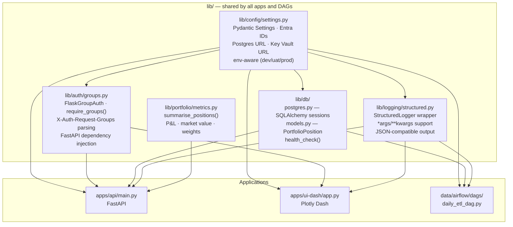

**Write once, use everywhere:**
A bug fix in `lib/auth/groups.py` is automatically applied to both the API and the Dash app in the same commit. No sync required.

---

## Slide 6 — Branch-Based SDLC

```mermaid
gitGraph
   commit id: "feat: new DAG"
   branch feature/new-dag
   checkout feature/new-dag
   commit id: "add DAG logic"
   commit id: "add tests"
   checkout main
   branch develop
   checkout develop
   merge feature/new-dag id: "PR: feature → develop"
   commit id: "CI deploys to DEV"
   branch uat
   checkout uat
   merge develop id: "PR: develop → uat"
   commit id: "CI deploys to UAT"
   checkout main
   merge uat id: "PR: uat → main"
   commit id: "CI deploys to PROD"
```

**Each branch maps to an environment:**

| Branch | Environment | Trigger |
|--------|-------------|---------|
| `develop` | **dev** | Any merge to develop |
| `uat` | **UAT** | Promote develop → uat |
| `main` | **prod** | Promote uat → main |

**Branch protection rules ensure:**
- PRs required with at least 1 reviewer
- All CI checks must pass before merge
- No direct pushes to `main` or `uat`

---

## Slide 7 — CI/CD Pipeline Detail

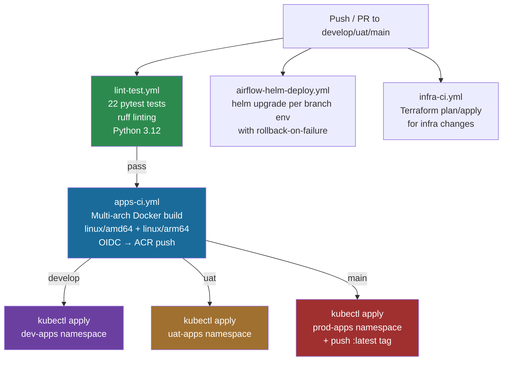

**No secrets in CI:** GitHub Actions uses OIDC federation with Azure — no stored credentials, no expiry, no rotation needed.

---

## Slide 8 — Centralized, Safe Configuration Management

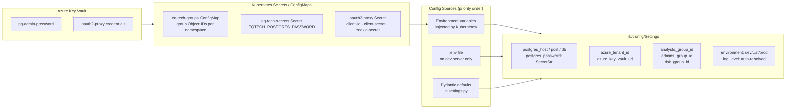

**Key principles:**
- `SecretStr` type — secrets never appear in logs or stack traces
- Namespace isolation — dev pods only see dev secrets, prod pods only see prod secrets
- Single `get_settings()` call works identically in all three environments
- Developers never handle production credentials directly

---

## Slide 9 — Self-Hosted Airflow: The Right Choice

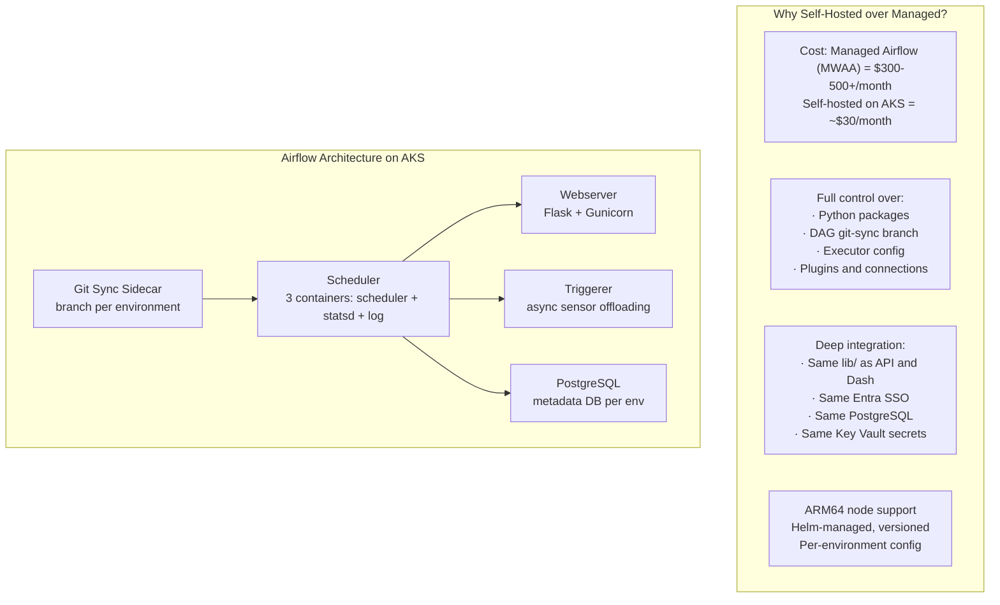

**One deployment configuration serves three environments:**

```yaml
# dev uses develop branch DAGs
dags.gitSync.branch: "develop"

# uat uses uat branch DAGs  
dags.gitSync.branch: "uat"

# prod uses main branch DAGs
dags.gitSync.branch: "main"
```

When a DAG is promoted from develop → uat → main, the live Airflow instance picks it up automatically via git-sync. No manual DAG uploads.

---

## Slide 10 — OAuth2 + Entra SSO: Zero-Trust Access

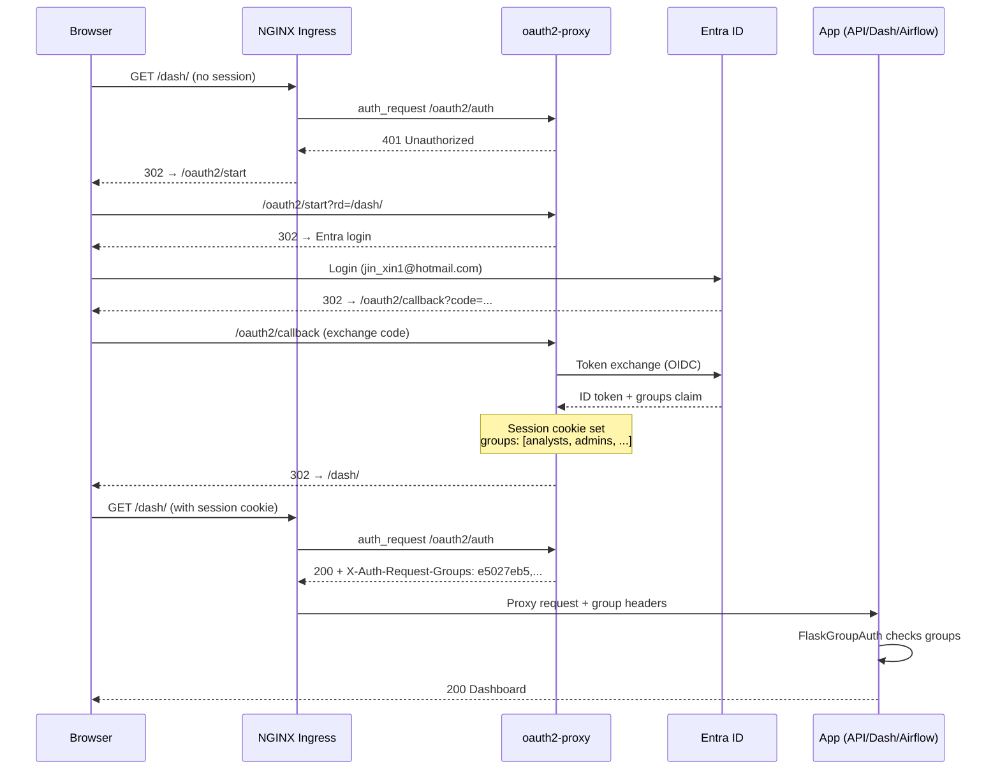

**Group-based RBAC without a single line of identity code in the apps.** The proxy injects `X-Auth-Request-Groups` and the shared `lib/auth/groups.py` enforces it.

---

## Slide 11 — The Central Dev Server

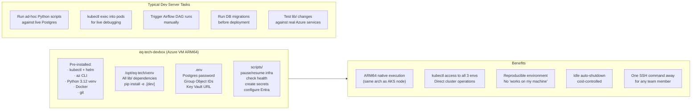

**Cost-aware:** The dev server auto-shuts down when idle (cron + auto-shutdown policy). `scripts/resume-devvm.ps1` brings it back on demand in ~60 seconds.

---

## Slide 12 — GitHub: The AI-Ready Backbone

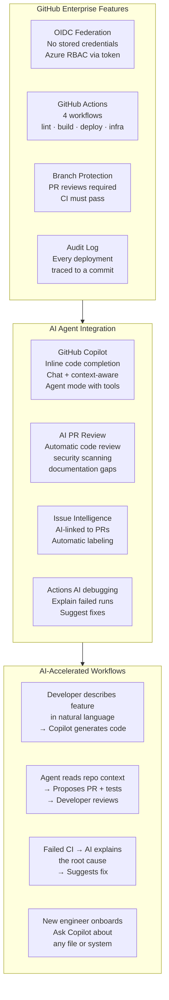

**This entire platform was built with GitHub Copilot as an AI pair programmer:** Infrastructure provisioning, CI/CD workflows, shared libraries, OAuth2 integration, TLS setup — all accelerated by AI agents that understand the full repository context.

---

## Slide 13 — Security Model

```mermaid
graph TD
    subgraph Network["Network Security"]
        LB[Azure LB\n52.185.94.105\nHTTPS only port 443]
        NSG[NSG Rules\nAllow Internet → LB only\nNo direct node access]
        TLS[Let's Encrypt TLS\nauto-renewed by cert-manager\nHTTP-01 via NGINX]
    end

    subgraph Identity["Identity & Access"]
        ENTRA2[Entra ID\nAzureADandPersonalMicrosoftAccount\ntenant-specific OIDC endpoint]
        GROUPS[Security Group RBAC\nanalysts · admins · risk · pm\nObject IDs in Entra]
        OIDC[OIDC Federation\nGitHub Actions → Azure\nNo stored credentials]
    end

    subgraph Secrets["Secret Management"]
        KV2[Azure Key Vault\nAll production secrets\nIAM-controlled access]
        K8S_SEC[Kubernetes Secrets\nnamespace-isolated\nnever in git]
        SECRET_STR[Pydantic SecretStr\nNever logged or printed\nget_secret_value() explicit]
    end

    subgraph Runtime["Runtime Isolation"]
        NS[Kubernetes Namespaces\ndev-apps · uat-apps · prod-apps\ndev-auth · uat-auth · prod-auth]
        POD[Pod identity\nWorkload Identity\nper-namespace service accounts]
    end

    LB --> Identity
    Identity --> Secrets
    Secrets --> Runtime
```

**Defense in depth:** Every layer has its own security boundary. A compromised dev pod cannot access prod secrets. A compromised prod pod cannot SSH to the dev server.

---

## Slide 14 — Platform Endpoints Summary

**Three environments, consistent structure:**

| Path | Service | Auth |
|------|---------|------|
| `https://{env}/` | Web UI (React/Nginx) | Entra SSO |
| `https://{env}/dash/` | Plotly Dash analytics | Entra SSO + group check |
| `https://{env}/api/v1/me` | User identity | Entra SSO |
| `https://{env}/api/v1/portfolio` | Portfolio data + P&L | Entra SSO + analysts/admins group |
| `https://{env}/api/docs` | Swagger UI | Entra SSO |
| `https://{env}/airflow/` | Airflow web UI | Entra SSO |
| `https://{env}/oauth2/start` | Login entrypoint | — |

**Environment hostnames:**

| Env | Hostname |
|-----|----------|
| Dev | `dev.eq-tech.52.185.94.105.nip.io` |
| UAT | `uat.eq-tech.52.185.94.105.nip.io` |
| Prod | `eq-tech.52.185.94.105.nip.io` |

---

## Slide 15 — Developer Experience: Day in the Life

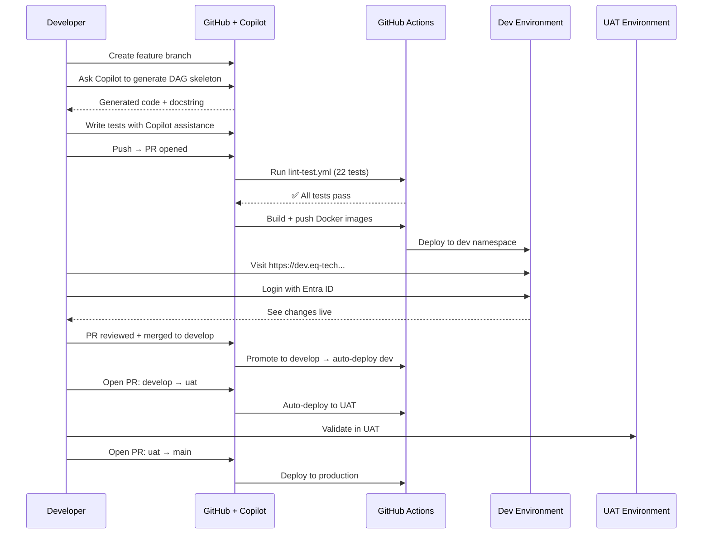

**Total time from idea to production: hours, not days.**

---

## Slide 16 — Operational Scripts

**Everything is scripted. Nothing requires the Azure portal.**

| Script | Purpose |
|--------|---------|
| `resume-infra.ps1` | Start AKS node + PostgreSQL + refresh kubectl |
| `pause-infra.ps1` | Stop all compute (saves ~$0.15/hr) |
| `resume-devvm.ps1` | Start dev server, print SSH command |
| `pause-devvm.ps1` | Deallocate dev server |
| `check-infra-health.ps1` | Azure resources + k8s pods + HTTP endpoints status |
| `setup-tls-oauth.ps1` | Deploy cert-manager + per-env oauth2-proxy + TLS |
| `create-pg-secrets.ps1` | Provision k8s secrets from Key Vault |
| `configure-entra-app.ps1` | Set up Entra app registration + k8s oauth2-proxy secrets |
| `port-forward.ps1` | Local dev access to all services |
| `test-endpoints.ps1` | Smoke-test all 12 service endpoints |

**Result:** Any engineer can operate the entire platform with no Azure portal access required.

---

## Slide 17 — Cost Architecture

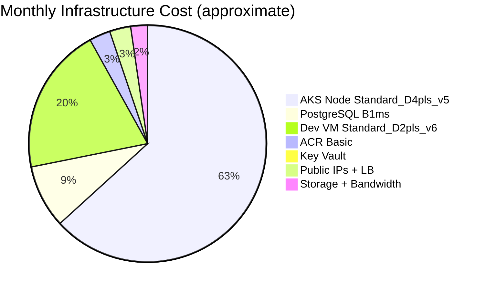

**Cost optimization built in:**
- ARM64 nodes (D4pls_v5) — 30% cheaper than equivalent x86
- PostgreSQL Flexible Server B1ms — smallest tier for dev workloads
- AKS Free tier — no control plane cost
- Idle auto-shutdown on dev server
- `pause-infra.ps1` — scales to ~$4/month during off hours (storage only)
- Single node cluster — all 3 environments share 1 node

**Estimated total: ~$175/month running / ~$4/month paused**

---

## Slide 18 — Why This Architecture Scales

**Today (single-node demo cluster):**
- 1 × ARM64 node running dev + UAT + prod simultaneously
- All services co-located with resource limits enforced
- Adequate for development and stakeholder demos

**Tomorrow (scale-out path):**

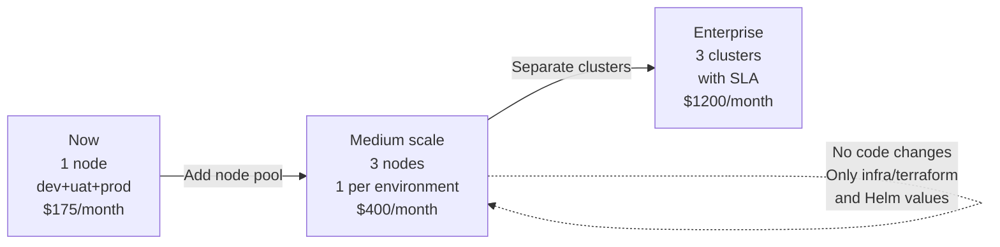

**The application code, CI/CD workflows, and security model require zero changes to scale.** Only the Terraform variables change.

---

## Slide 19 — Key Takeaways

**The mono-repo approach delivers:**

1. **Speed** — Feature to production in hours via branch-based SDLC + automated CI/CD
2. **Safety** — Zero secrets on developer machines; Entra SSO + group RBAC enforced at the proxy
3. **Consistency** — Dev, UAT, and prod are structurally identical — bugs don't hide in environment differences
4. **Discoverability** — Every piece of the system is one `git grep` away
5. **AI-ready** — GitHub Copilot has full repository context, enabling AI-assisted development across all layers
6. **Operability** — Every operational task is a PowerShell script; no portal required
7. **Cost control** — ARM64 nodes, pause scripts, and per-environment resource limits keep costs predictable

**The platform demonstrates that financial engineering infrastructure can be:**
- **Professional** — TLS everywhere, Entra SSO, audit trails
- **Affordable** — ~$175/month for 3 full environments
- **Maintainable** — 22 automated tests, shared libraries, documented scripts
- **AI-accelerated** — Built with and for GitHub Copilot

---

## Slide 20 — Thank You

**EQ Tech Platform Stack**

| Layer | Technology |
|-------|-----------|
| Cloud | Microsoft Azure (centralus) |
| Compute | AKS (ARM64) + Azure VM |
| Container Registry | Azure Container Registry |
| Database | PostgreSQL 16 Flexible Server |
| Secret Management | Azure Key Vault |
| Identity | Entra ID + oauth2-proxy |
| Ingress | NGINX Ingress Controller + cert-manager |
| Orchestration | Apache Airflow 2.11 (Helm) |
| API | FastAPI + SQLAlchemy |
| Dashboard | Plotly Dash |
| CI/CD | GitHub Actions (OIDC) |
| IaC | Terraform |
| Language | Python 3.12 |
| Config | Pydantic Settings |
| AI Tooling | GitHub Copilot (Claude Sonnet) |

**Repository:** `github.com/ColumbiaDataScienceCorporation/eq_tech`

---

*Generated with GitHub Copilot (Claude Sonnet 4.6) — an AI agent with full repository context*
